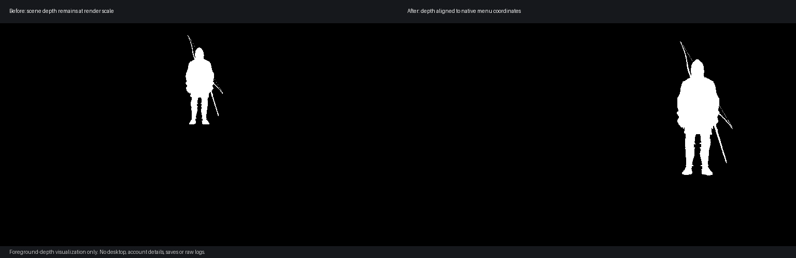

# Inventory portrait depth alignment

## Problem and reproduction

On the Steam 1.9.8 renderer, open the inventory/equipment screen after loading a
save. At Quality (66.7%), the portrait can disappear while a smaller black
silhouette remains above and to the left of its intended position. Switching to
DLAA (100%) restores the portrait.

This was reproduced with Clarity alone; frame generation and neural-rendering
plugins are not required to trigger it. In the captured failing frame, the DLSS
output and TAA target already contained the correctly enlarged, coloured model.
The final menu was wrong. Both native and failing captures had zero alpha at the
TAA target, and tracing 374 subsequent draws found no alpha-only correction pass.

The Scaleform menu uses the scene depth buffer with a `GREATER_EQUAL` test at
native resolution. The scene depth still occupies the lower-resolution sub-rect,
so menu occlusion follows the old small portrait instead of its upscaled colour.



This figure shows only the foreground-depth mask from one capture, with no menu,
desktop, account details or image metadata. Its display threshold is for
illustration only; the runtime correction resamples all depth values and does not
segment characters by a threshold.

## Opt-in correction

Enable **Align menu depth (inventory portrait)** in F8, or set:

```ini
[dlss]
ui_depth_alignment=1
```

The setting defaults to off and is persisted. After a successful lower-resolution
TAA resolve, the correction runs before the first matching native-resolution
Scaleform solid-colour pass. It snapshots depth, nearest-resamples it using the
actual render/target dimensions, and writes `SV_Depth` to the original DSV.
Colour and stencil writes remain disabled. Device-context state is restored.

The operation is limited to one qualifying pass per TAA serial. Native 100%
rendering bypasses it. It also requires the expected shader binding layout,
depth comparison, native viewport and target sizes, a single-sample 2D DSV, and
no second render target; unmatched layouts are left unchanged.

This addresses inventory composition. It does not fix unrelated sub-rect effects,
edge padding, shadows, or all possible lower-resolution rendering problems.

## Validation and limits

Manual game validation used RTX 4060 8 GB at 2560x1440, Quality 66.7%, with the
sub-rect fixes from PR #1, commit `804f442b6d8d8283fd311f07321b1a354f5d8d26`.
This PR is isolated against `main`; that exact standalone integration is compiled
and tested offscreen, but has not replaced the working game installation.

- The failing capture's 57,085 nearer portrait-depth pixels all coincided with
  the final small black silhouette.
- Enabling the correction restored portrait position and colour and removed the
  black silhouette. Repeated inventory/map opening and closing remained correct.
- A restart with the saved setting enabled remained correct.
- The successful depth export moved the small portrait's bounds into the
  intended native-resolution area. The colour/stencil-independent mechanism was
  checked separately using synthetic D24S8 data.
- Other ratios have representative offscreen mapping coverage; they are not
  claimed as fully game-tested. Other GPUs, game builds, and long sessions remain
  untested.

Configure with `-DKCD_BUILD_TESTS=ON`, build, then run `ctest --test-dir build`.
The WARP test creates its own textures and INI. It checks setting persistence,
off/native bypass, depth scaling, preservation of every colour/stencil pixel,
context-state restoration, and preventing repeated resampling in one frame.
It does not require or alter a game installation.

No game files, proprietary runtime DLLs, user paths, saves, credentials or raw
session logs are included in this contribution.
